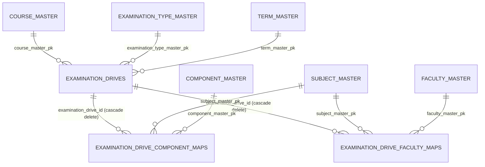

# Examination Drive — Flow, Design & Database Structure

URL analyzed: `http://127.0.0.1:8000/master/examination-drive`
Route name: `master.examination.drive.index` · Controller: `App\Http\Controllers\Admin\ExaminationDriveController@index`
Part of the broader "Examination & Result Management System" — see [examination-result-management-progress.md](examination-result-management-progress.md) for full project status (this file documents only the Examination Drive module and its direct dependencies in isolation).

---

## 1. What this page is

The Examination Drive is the central transactional entity that ties together **course + academic session + examination type + term + phase** into one record, e.g. "Mid-Term Exam, Phase-II, PGPPM 2026, Term 1". Everything downstream (subject/component mapping, faculty mapping, and future stages — venue allocation, question papers, evaluation, results) hangs off a specific `examination_drives.id`.

It sits at **stage 3** of a 16-stage workflow:

```
1. Course Setup → 2. Participants & Roll No. → 3. Examination Drive → 4. Subjects & Components
→ 5. Data Source Mapping (folded into #4) → 6. Faculty Mapping → 7. Venue & Laptop Allocation
→ 8. Question Paper & Translation → 9-10. Online/Offline Examination → 11. Evaluation & Marks Fetch
→ 12. Moderation & Conversion → 13. Result Compilation → 14. Marksheet & Certificate
→ 15. Awards & Medals → 16. Reports & Analytics
```

Only stages 3, 4 (incl. 5) and 6 are built. Stage 7 onward is not started.

---

## 2. Page flow (UI)

```mermaid
flowchart TD
    A[GET /master/examination-drive] --> B[ExaminationDriveController::index]
    B --> C[Yajra DataTable render\nindex.blade.php]
    C --> D{User action}
    D -->|Create/Edit| E[Modal form -> POST .../store]
    D -->|Delete| F[DELETE .../destroy/id]
    D -->|Map Subjects & Components| G[GET examination-drive/id/components]
    D -->|Faculty Mapping| H[GET examination-drive/id/faculty]
    D -->|Export| I[GET .../export?format=print|pdf|excel]

    G --> G1[ExaminationDriveComponentMapController::show]
    G1 --> G2[Add Subject/Component rows, set max/passing marks, source, weightage]
    G2 --> G3[POST store -> delete-all then bulk reinsert]

    H --> H1[ExaminationDriveFacultyMapController::show]
    H1 --> H2[Pick Faculty per mapped subject]
    H2 --> H3[POST store -> upsert per subject]
```

### Listing (`index`)
- Course dropdown is scoped by `get_Role_by_course()` (role-based course access control) and by Active/Archived tab (`course_master.end_date` vs today).
- Grid (`ExaminationDriveDataTable`) shows exam type, term, course, phase, academic session, dates, status badge (Draft/Published/Closed), and row actions: Edit, Map Subjects & Components (`bi-diagram-3`), Faculty Mapping (`bi-person-badge`), Delete.
- Grid query is also scoped by `get_Role_by_course()` so a course-restricted user only sees their drives.

### Create / Edit (`store`)
- Single modal, same endpoint for both (presence of hidden encrypted `id` decides update vs insert).
- Validates: `examination_type_master_pk`, `term_master_pk`, `course_master_pk` all `exists:`; `phase` against `ExaminationDrive::PHASES`; `academic_session` as a 4-digit year; `start_date`/`end_date` (end ≥ start); `status` against `ExaminationDrive::STATUS_LABELS` keys.

### Delete (`destroy`)
- `ExaminationDrive::findOrFail(decrypt($id))->delete()` — cascades to `examination_drive_component_maps` and `examination_drive_faculty_maps` via FK `cascadeOnDelete()`.

### Export (`export?format=print|pdf|excel`)
- Reuses the exact same role-scope + Active/Archived + course filter as the grid (`filteredDrivesQuery()`), so an export can never show more rows than the grid.
- `print` → Blade view; `pdf` → DomPDF (A4 landscape, branded header); `excel` → Maatwebsite `ExaminationDriveExport` (FromCollection).

### Subject & Component Mapping (stage 4, folds in stage 5 "Data Source Mapping")
- `GET examination-drive/{driveId}/components` → spreadsheet-style grid, one row per Subject+Component.
- Each row: Subject (dropdown), Component (dropdown), Max Marks, Passing Marks, **Source** (Faculty / System / Manual Entry — this is the "Data Source Mapping" requirement, no separate screen/table), Weightage.
- `POST .../components` is a **bulk delete-then-reinsert** per drive: validates per-row `passing_marks <= max_marks` and that `SUM(weightage)` across the drive equals 100, then wipes all existing `examination_drive_component_maps` rows for that drive and reinserts the posted set.

### Faculty Mapping (stage 6)
- `GET examination-drive/{driveId}/faculty` → one row per subject already present in that drive's component map (not a free subject list).
- `POST .../faculty` upserts one faculty per subject for the drive (unique on `(examination_drive_id, subject_master_pk)`).

All `{driveId}` route params are `encrypt()`-wrapped ids, `decrypt()`ed inside each controller.

---

## 3. Entity-relationship diagram



---

## 4. Database structure (exact column definitions, from migrations)

### Convention notes
- Lookup `*_master` tables use custom PK column `pk` (`bigIncrements('pk')`), not `id`.
- Transactional tables (`examination_drives`, mapping tables) use standard `id`.
- FK columns pointing at a master table are named `<table>_pk`.
- Timestamps are `created_date` / `modified_date` (not Laravel's default `created_at`/`updated_at`); models set `public $timestamps = false`.

### `examination_type_master` (new)
| Column | Type | Notes |
|---|---|---|
| `pk` | bigIncrements (PK) | |
| `exam_type_name` | string(100) | unique |
| `active_inactive` | tinyInteger, default 1 | indexed |
| `created_date` | timestamp, useCurrent | |
| `modified_date` | timestamp, useCurrent/useCurrentOnUpdate | |

### `term_master` (new)
Same shape as above, with `term_name` (unique) instead of `exam_type_name`.

### `component_master` (new)
Same shape as above, with `component_name` (unique) instead of `exam_type_name`.

### `examination_drives` (new — the core entity)
| Column | Type | Notes |
|---|---|---|
| `id` | bigIncrements (PK) | |
| `examination_type_master_pk` | unsignedBigInteger | FK → `examination_type_master.pk`, `restrictOnDelete` |
| `term_master_pk` | unsignedBigInteger | FK → `term_master.pk`, `restrictOnDelete` |
| `course_master_pk` | unsignedBigInteger | FK → `course_master.pk`, `restrictOnDelete` |
| `phase` | string(20) | fixed list (Phase-I..Phase-IV), validated in controller only — **no master table** |
| `academic_session` | year | |
| `start_date` | date | |
| `end_date` | date | must be ≥ `start_date` |
| `status` | tinyInteger, default 0 | 0=Draft, 1=Published, 2=Closed |
| `created_by` | unsignedBigInteger, nullable | user id |
| `created_date` | timestamp, useCurrent | |
| `modified_date` | timestamp, useCurrent/useCurrentOnUpdate | |

Indexes: `academic_session`; `status`; composite `(course_master_pk, academic_session)`.

### `examination_drive_component_maps` (new — stages 4 & 5)
| Column | Type | Notes |
|---|---|---|
| `id` | bigIncrements (PK) | |
| `examination_drive_id` | unsignedBigInteger | FK → `examination_drives.id`, `cascadeOnDelete` |
| `subject_master_pk` | unsignedBigInteger | FK → `subject_master.pk`, `restrictOnDelete` |
| `component_master_pk` | unsignedBigInteger | FK → `component_master.pk`, `restrictOnDelete` |
| `max_marks` | decimal(6,2) | |
| `passing_marks` | decimal(6,2) | must be ≤ `max_marks` (controller rule) |
| `source` | string(30), default 'Faculty' | Faculty / System / Manual Entry — this *is* "Data Source Mapping" (stage 5), no separate table |
| `weightage` | decimal(5,2) | SUM per drive enforced = 100 in controller (⚠️ unverified against spec, see §6) |
| `created_date` / `modified_date` | timestamp | |

Unique `(examination_drive_id, subject_master_pk, component_master_pk)` as `ed_component_map_unique`. Index on `examination_drive_id`.

### `examination_drive_faculty_maps` (new — stage 6)
| Column | Type | Notes |
|---|---|---|
| `id` | bigIncrements (PK) | |
| `examination_drive_id` | unsignedBigInteger | FK → `examination_drives.id`, `cascadeOnDelete` |
| `subject_master_pk` | unsignedBigInteger | FK → `subject_master.pk`, `restrictOnDelete` |
| `faculty_master_pk` | unsignedBigInteger | FK → `faculty_master.pk`, `restrictOnDelete` |
| `created_date` / `modified_date` | timestamp | |

Unique `(examination_drive_id, subject_master_pk)` as `ed_faculty_map_unique` — one faculty per subject per drive.

### Reused pre-existing tables (not modified)
`subject_master` (`pk`, `subject_name`, `active_inactive`), `faculty_master` (`pk`, `full_name`, `active_inactive`), `course_master`.

---

## 5. Models, controllers & routes

| Model | Table | Key members |
|---|---|---|
| `App\Models\ExaminationTypeMaster` | `examination_type_master` | `scopeActive()` |
| `App\Models\TermMaster` | `term_master` | `scopeActive()` |
| `App\Models\ComponentMaster` | `component_master` | `scopeActive()` |
| `App\Models\ExaminationDrive` | `examination_drives` | const `STATUS_DRAFT/PUBLISHED/CLOSED`, `STATUS_LABELS`, `PHASES`; relations `examinationType()`, `term()`, `course()` |
| `App\Models\ExaminationDriveComponentMap` | `examination_drive_component_maps` | const `SOURCES`; relations `drive()`, `subject()`, `component()` |
| `App\Models\ExaminationDriveFacultyMap` | `examination_drive_faculty_maps` | relations `drive()`, `subject()`, `faculty()` |

| Route name prefix | Controller | Methods |
|---|---|---|
| `master.examination.drive.index` | `Admin\ExaminationDriveController` | `index` (Yajra render) |
| `master.examination.drive.get.courses.by.status` | same | `getCoursesByStatus` |
| `master.examination.drive.export` | same | `export` (print/pdf/excel) |
| `master.examination.drive.store` | same | `store` (create/update) |
| `master.examination.drive.destroy` | same | `destroy` |
| `master.examination.drive.components.show/store` | `Admin\ExaminationDriveComponentMapController` | per-drive subject/component grid |
| `master.examination.drive.faculty.show/store` | `Admin\ExaminationDriveFacultyMapController` | per-drive faculty grid |

Views: `resources/views/admin/examination_drive/{index,components,faculty_mapping,export_print,export_pdf}.blade.php`.

---

## 6. Known issues / open findings (carried from project handoff doc)

- **P1 — weightage=100 rule unverified**: controller hard-rejects saves unless `SUM(weightage)` per drive equals 100; spec infographic suggests weightage may instead be "marks contributed" per subject, not a shared percentage pool. Confirm before building later stages.
- **P2 — duplicate component row returns HTTP 500** (`QueryException` instead of 422) due to unhandled unique constraint violation.
- **P2 — permission scoping incomplete**: `store`/`destroy` on drives and `show` on both mapping controllers don't check course-scope, only rely on `decrypt()`ed ids being hard to guess.
- **P2 — re-saving component map orphans faculty rows**: component map does delete-all+reinsert; faculty map rows for removed subjects are never cleaned up.
- **P2 — faculty map store not drive-scoped**: validates subject/faculty exist in their masters, not that the subject belongs to this drive.
- **P3 — unguarded `decrypt()`**: a tampered `{driveId}` throws `DecryptException` → 500 instead of 404.
- **P3 — no status guard**: a **Closed** drive is still fully editable via both mapping screens.

Full detail and QA data counts: [examination-result-management-progress.md](examination-result-management-progress.md).
